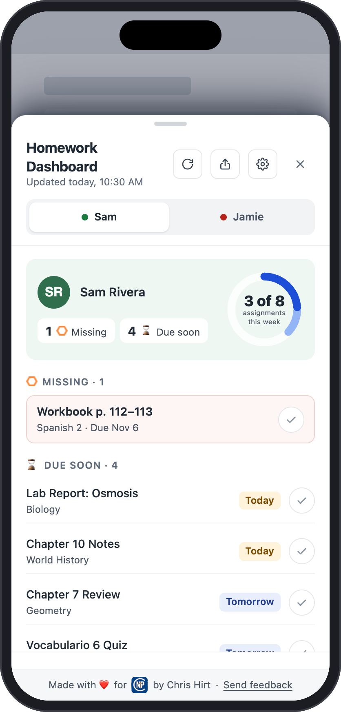

# Grades Dashboard for Schoology

**Know what's due, what's missing, and how grades are going.**

 

## What it is

A free browser extension that puts one calm page on top of Schoology. It
shows what's missing, what's due soon, and how each class is going.

## Who it's for

- **Parents:** see missing work and low grades at a glance, with an
  optional GO / NO-GO for the day. Email the right teacher in two taps.
- **Students:** see what to finish first, this week's progress, and
  personal bests.

## Private by design

Everything stays on your device. There's no account to create, no server,
and your Schoology password is never stored.
[Privacy policy](https://megahirt.github.io/schoology-grades-extension/privacy.html).

## Get it

Store listings for Safari, Chrome, Edge and Firefox are on the way. To try
it now on a computer, see the
[install page](https://megahirt.github.io/schoology-grades-extension/install.html).

## For developers

Building, testing and releasing: [DEVELOPER.md](DEVELOPER.md).

---

Made with ❤️ for North Point Christian families by Chris Hirt.
Not affiliated with Schoology or PowerSchool. [MIT License](LICENSE).
